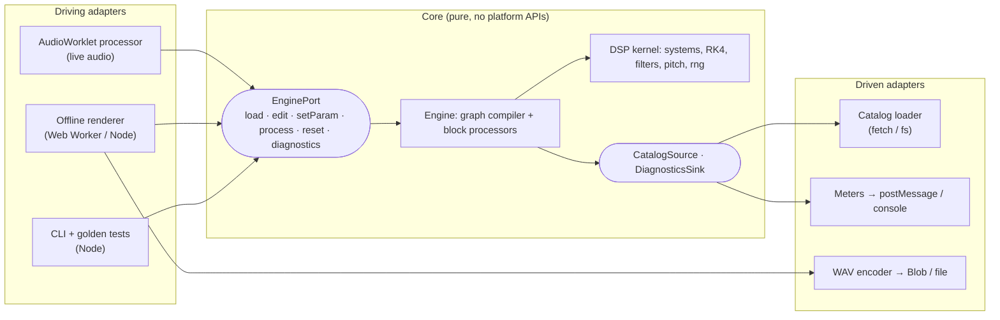

# 0011. Hexagonal architecture (ports and adapters), with a seam for a C++ core

- Status: Accepted (owner's decision, 2026-10-26)
- Date: 2026-10-26
- Related: ADR 0002 (TypeScript first), ADR 0004 (one engine runs the patch)

## Context

The owner wants TypeScript first, but with an architecture that makes a later move of the
engine to C++ easy, and asked explicitly for a hexagonal architecture. The engine must run in
several places: the browser's audio thread (AudioWorklet), a Web Worker (WAV export), Node
(tests and a command-line renderer), and possibly native code later.

## Decision

The engine is a **core** surrounded by **ports** (interfaces the core owns) and **adapters**
(platform code that implements or drives those interfaces).



Rules:

1. **The core is pure.** No DOM, Web Audio, Node, `fetch`, timers or file access, and no
   `async`. Inputs arrive as plain data (patch JSON, catalog JSON, numbers, typed arrays);
   outputs are typed arrays and plain objects. A test enforces this by scanning the core's
   imports and globals.
2. **Dependencies point inward.** Adapters import the core; the core never imports an
   adapter. The core defines the port interfaces; adapters implement them.
3. **The driving port is narrow and data-oriented:**

   ```ts
   interface EnginePort {
     load(patch: PatchDocument, catalog: CatalogDocument, sampleRate: number): void;
     edit(e: PatchEdit): void;                       // add/remove block, connect, …
     setParam(blockId: string, name: string, value: number | string | boolean): void;
     process(frames: number, left: Float32Array, right: Float32Array): void;
     reset(): void;
     diagnostics(): Record<string, Record<string, number>>;
   }
   ```

   Everything crossing it is JSON-serializable or a flat numeric buffer. That is exactly
   what a C++ implementation compiled to WebAssembly (Emscripten/embind) can expose.
4. **The DSP kernel is written C-style.** Inside the core, the per-sample code (system RHS,
   RK4, filters) uses typed arrays and scalar locals: no closures, object allocation or
   polymorphism in hot loops. It maps one-to-one onto C++ functions and structs, so it can be
   ported module by module.
5. **Language-neutral contracts define correctness, not any one implementation:**
   - the spec (`docs/spec-v1.md`), with exact recurrences and formulas;
   - the patch JSON and catalog JSON formats;
   - golden test vectors exported by the Python reference (`examples/golden/`).

   Any engine (Python, TypeScript, or a future C++ one) must pass the same golden tests.

## Consequences

- **Moving to C++ later** means implementing `EnginePort` in C++, compiling it to WASM,
  wrapping it in a thin TS class with the same interface, and running the golden tests.
  The adapters (worklet, offline, CLI), the UI and the formats are unchanged.
- The worklet adapter stays tiny: it translates messages into port calls and copies buffers.
- The Python lab follows the same split on a small scale:
  - core: `systems`, `integrate`, `dsp`, `pitch`, `rng`, `blocks`, `patch`, the catalog model;
  - port: `BlockContext` supplies the catalog to blocks;
  - adapters: catalog file IO (`Catalog.load/save`, `load_default_catalog`), `wav.py`,
    `scripts/`.

  Blocks never read files.
- There is some up-front structure: the interfaces, the import-rule test and golden vectors.
  It is small, and it is the price of keeping the C++ option real.

## Alternatives considered

- **A conventional layered design without explicit ports.** Simpler at first, but the audio
  APIs leak into the engine, which makes a language swap a rewrite.
- **Writing the core in C++ from the start.** Rejected for now (ADR 0002): a heavier
  toolchain, and harder for the owner to read. The seam above keeps the option open.

## Implementation notes (2026-10-26)

- The driven ports drawn above turned out unnecessary. The catalog reaches the core as data
  in `EnginePort.load()` (reading the file is an adapter's job), and the adapters poll
  `diagnostics()`. The unused `DiagnosticsSink` interface was removed from `ports.ts`.
  The dependency rule is unchanged.
- `test/architecture.test.ts` now tokenizes each core file. It catches side-effect and
  dynamic imports, imports outside `src/core`, JSON imports, aliased globals, `Function`,
  `Promise`, timers, `Date` and `Math.random`. Its own fixtures check that it catches 15
  known bypasses.
- Golden tests still read two internal values (each dynamical block's initial state and
  the modulator outputs) through the TypeScript classes. A C++ core will need a data-only
  probe on the port for those two checks (open item in `docs/REVIEW.md`).

