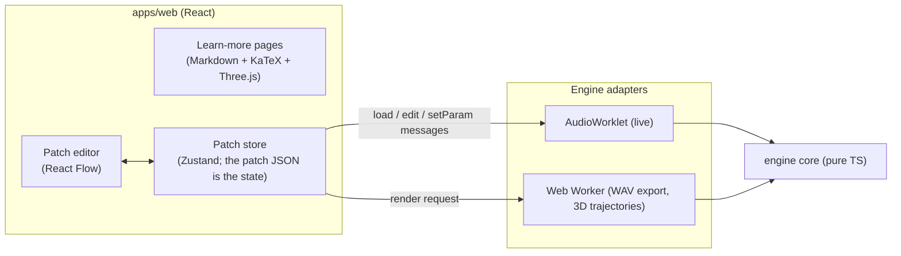

# Design sketch: the web app (Phase 3)

- Status: **design sketch** (2026-10-26). Nothing is implemented beyond the developer
  playground (`apps/playground`).
- Decisions it relies on: ADR 0001 (static site), ADR 0011 (hexagonal: the UI is a driving
  adapter of the engine), spec v0.3.

## 1. Goals for the MVP

1. **A patch editor.** Add, move and delete boxes (Modulator, Dynamical, Sum, Control Sum,
   Output). Draw cables between compatible ports. Turn knobs. Play and stop. Export a WAV.
2. **Learn more.** Each dynamical box opens a page with:
   - a rotating 3D view of its attractor;
   - the equations, with the knob's parameter highlighted;
   - the history and properties (from `docs/systems/<name>.md`, after the owner's review).
3. **Save and load.** Patches are saved to the browser's local storage, and exported and
   imported as JSON files in the spec §5 format.
4. **Works without a server**: a static build on GitHub Pages, Cloudflare Pages or the
   owner's own host.

## 2. Architecture

- **The patch JSON is the single source of truth.** Every UI action becomes a `PatchEdit` or
  a `setParam`. The store applies it to its document (with the engine's own `applyEdit`, so
  both share the same validation) and sends the same message to the worklet. Undo and redo
  are a stack of documents.
- **The UI never touches audio directly.** It only talks to the adapters, so swapping the
  engine for a C++/WASM core later does not touch the UI (ADR 0011).
- **3D trajectories come from the core.** The core's RK4 kernel already integrates the
  systems, so a Web Worker computes about 20 000 points of the attractor at the box's current
  parameter. No precomputed data is needed, and the view follows the knob.

## 3. Libraries

| Need | Choice | Why |
|---|---|---|
| UI framework | React 19 | Largest ecosystem; React Flow is built for it |
| Node editor | React Flow (`@xyflow/react`) | The standard for node-based editors; typed handles fit audio and control ports |
| State | Zustand | Tiny, no boilerplate; holds the patch document |
| 3D | Three.js via `@react-three/fiber` | The standard WebGL stack |
| Equations | KaTeX | Fast, and the system modules already hold KaTeX-ready LaTeX |
| Markdown | `react-markdown` + `remark-math` + `rehype-katex` | Renders `docs/systems/*.md` directly |
| Build | Vite (already used by the playground) | Bundles the worklet with `?worker&url` |
| Tests | Vitest + Testing Library; Playwright for one end-to-end "press Play" test | |

## 4. Box UI (per spec §4)

| Box | Face | Ports (colour = type) |
|---|---|---|
| Modulator | shape picker (icons), period in seconds, loop/once toggle, a tiny live scope | out ● control |
| Dynamical | system picker, note + cents, knobs `param` and `amp`, pitch-lock and amp-curve toggles, observable picker, "Learn more" button, a small live 2D phase portrait | in: param, amp, pitch ● control; out ● audio |
| Sum | gain knob | in ● audio (many); out ● audio |
| Control Sum | gain knob | in ● control (many); out ● control |
| Output | volume knob, Play/Stop, Export WAV, level meter | in ● audio |

- **Knobs are 0 → 1** everywhere, except notes and seconds (ADR 0005). A dynamical box's
  `param` knob shows the real parameter value as a subtitle, for example "ρ = 48.0".
- **Cables are only drawable between compatible ports.** React Flow's `isValidConnection`
  uses the engine's own port specs (`BLOCK_SPECS`). A second cable into a control input
  shows the "use a Control Sum box" hint from the engine's error.

## 5. Open questions for the owner

1. Visual style: a hardware-synth look (knobs, panels) or a clean diagram look?
2. The order of the Learn-more pages: equations first, or history first?
3. Should the default patch on first visit be a single Rössler box, or the owner's
   two-modulator example?
4. Mobile: is a read-only view (play the examples, read the pages) enough for v1?
