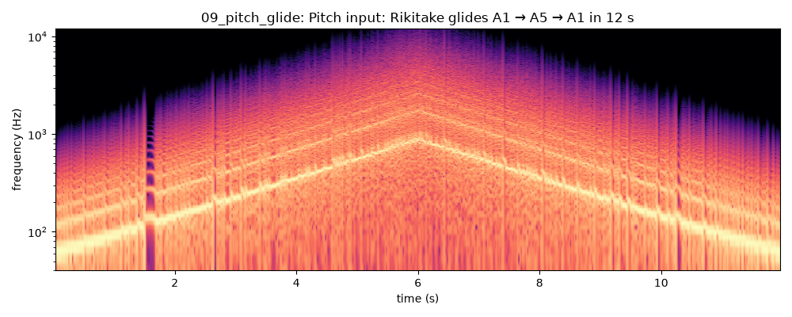
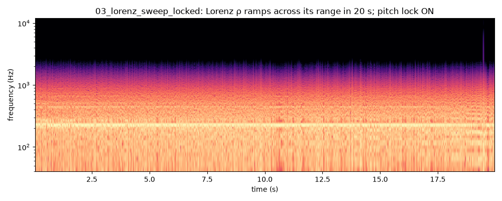
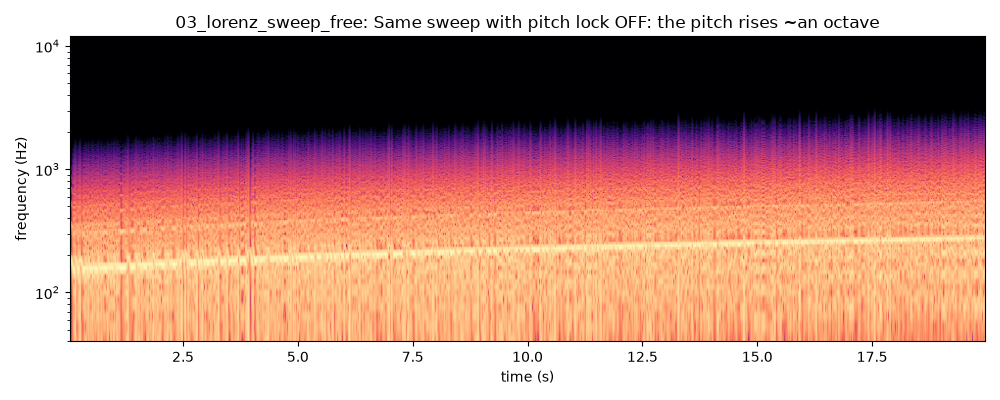
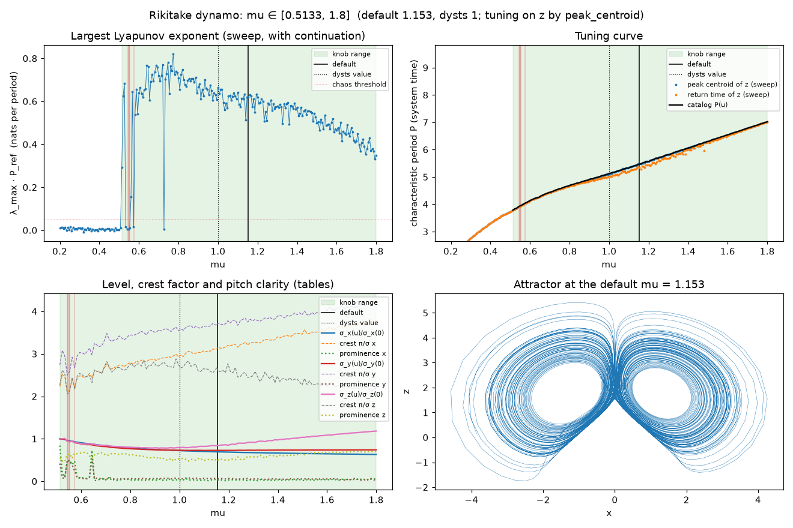

# Tuning chaos to a note

- Status: Phase 1 results, updated for engine v0.3 and catalog v2 (2026-10-26).
- Numbers come from `catalog/systems.json` and the lab scripts. Rerun them with
  `lab/scripts/build_catalog.py` and `lab/scripts/render_demos.py`.
- Decisions: ADR 0006 (time rescaling), ADR 0010 (period estimation), ADR 0012 (range
  selection), ADR 0013 (controls).

## 1. Tuning is a rescaling of time

A system is an autonomous ODE in its own time τ:

$$\frac{dx}{d\tau} = F(x;\,p).$$

Its main oscillation has a **characteristic period P**, in system-time units. To hear it at
the frequency f₀ (Hz), let the system's clock run k times faster than real time t (seconds):

$$\tau = k\,t,\qquad k = P\,f_0 \quad\Longrightarrow\quad \frac{dx}{dt} = k\,F(x;\,p).$$

One period P of system time now lasts 1/f₀ seconds. Three consequences:

- **The timbre does not depend on the pitch.** The trajectory, and so the waveform shape, is
  the same at every k. Only its speed changes. `08_rossler_A2_to_A5.wav` demonstrates this.
- **The integration step is independent of the sample rate.** Each audio sample at rate fs
  advances the system by Δτ = k/fs = P·f₀/fs. We take n = ⌈Δτ/h_max⌉ equal RK4 sub-steps.
  h_max is fixed in system time (h_max = P_min/N, with N = 256 steps per period and P_min the
  shortest period over the range, or P at the dysts value if that is shorter; for the five v2
  systems it is the range minimum). The cost is therefore ⌈N·(P(u)/P_min)·f₀/fs⌉ RK4 steps
  per sample. P(u)/P_min stays between 1 and 1.86 (Lorenz) across the ranges, so at A4 and
  48 kHz a box takes 3–4 sub-steps at its default and at most 5 anywhere in its range (§4).
- **Moving a parameter is forcing.** When a modulator moves p(t), the system becomes
  non-autonomous, which is the owner's point that modulation is equivalent to forcing. For
  slow modulation the trajectory follows the attractor of the current p adiabatically.
  Faster modulation is genuine forcing (see `docs/studies/modulation.md`).

## 2. What is "the" period?

The owner proposed two definitions: the most prominent spectral frequency, or the period of
the most visited unstable periodic orbit (UPO). Two facts shaped the implementation.

**The period depends on which variable you look at.** dysts lists P = 1.50 for Lorenz.
At dysts' ρ = 28, Lorenz's z, however, loops with a period of 0.75, an octave higher. The x
and y variables are dominated by slow, random switching between the two lobes and are hardly
pitched: their spectral prominence there is 0.04–0.05, against 0.43 for z.

The spectral **prominence** is the fraction of the power within ±3% of the peak. It measures
how pitched a variable sounds. The lab picks the tuning variable at the dysts value of the
parameter, before it chooses the range and the default. The most pitched variables there,
and at the catalog v2 default:

| System | Most pitched variable | Prominence at the dysts value | Prominence at the v2 default |
|---|---|---|---|
| Rössler | x | 0.85 (c = 5.7) | 0.79 (c = 6.5625) |
| Chua | y | 0.60 (α = 15.6) | 0.65 (α = 15.8) |
| Rikitake | z | 0.54 (μ = 1) | 0.53 (μ = 1.1533) |
| Lorenz | z | 0.43 (ρ = 28) | 0.43 (ρ = 48.03) |
| Duffing | y | 0.24 (γ = 0.35) | 0.30 (γ = 0.44708) |

The same variable is the most pitched at both points. Catalog v1 also had Thomas, whose
variables all had a prominence of about 0.1–0.25. It was dropped (ADR 0012).

**Estimators differ in stability.** For each system we ran 12 consecutive stretches of 2000
periods each and measured how much each estimator spread between stretches (standard
deviation in cents; 100 cents = 1 semitone). Bold marks the estimator the catalog uses.

| System, at the dysts value | Highest bin of the peak | **Peak centroid (±10%)** | Return time between maxima |
|---|---|---|---|
| Lorenz (z), ρ = 28 | 4.5 | **2.3** | 2.9 |
| Rössler (x), c = 5.7 | 0.3 | **0.3** | 0.2 |
| Chua (y), α = 15.6 | 11.0 | **3.1** | 3.6 |
| Rikitake (z), μ = 1 | 7.7 | **3.8** | 5.8 |
| Duffing (y), γ = 0.35 | 0.1 | 0.4 | 15.0 (drive period used instead) |

| System, at the v2 default | Highest bin of the peak | **Peak centroid (±10%)** | Return time between maxima |
|---|---|---|---|
| Lorenz (z), ρ = 48.03 | 1.9 | **1.4** | 1.0 |
| Rössler (x), c = 6.5625 | 0.2 | **0.2** | 0.2 |
| Chua (y), α = 15.8 | 3.8 | **2.2** | 3.0 |
| Rikitake (z), μ = 1.1533 | 3.9 | **2.8** | 5.9 |
| Duffing (y), γ = 0.44708 | 0.0 | 0.4 | 11.5 (drive period used instead) |

(Measured on catalog v2. At the dysts values, Lorenz, Rössler, Chua and Duffing give the same
numbers as on catalog v1. Catalog v1 also had Thomas (x): 24.7, 17.0 and 6.3 cents. It was the
only system tuned by the return time.) At its v2 default, Lorenz's return time is steadier
than the centroid (1.0 against 1.4 cents). The lab still uses the centroid there, because the
rule below chooses the method by prominence.

Chaotic peaks are broad and have sub-structure. The highest bin jumps between sub-peaks,
while the power-weighted centroid of the peak averages over them.

**What the lab does (ADR 0010):**

1. **One period per system.** It is measured on the variable with the most prominent peak at
   the dysts value of the parameter (the *tuning observable*), and used whatever variable is
   heard. x, y and z are views of the same oscillation, so the choice of variable changes the
   timbre, not the tuning.
2. **The method** (also chosen at the dysts value):
   - Forced systems use the exact drive period 2π/ω.
   - A pitched tuning observable (prominence ≥ 0.25) uses the **peak centroid**.
   - A broadband one uses the **mean return time between maxima**. Only Thomas (catalog v1)
     fell in this case; none of the five v2 systems does.
   - For forced systems, the drive period is used only if the tuning variable's measured
     period is within 2% of it (some forced systems respond at a multiple of the drive).
3. UPO-based tuning is kept as a research item (roadmap). The return time is its cheap
   relative: for phase-coherent attractors it equals the mean period of the main loop.

## 3. Pitch lock

The lab tabulates P(u) on 129 points over the knob range u ∈ [0, 1], plus an exact node at
the default value. Engines interpolate it linearly. With pitch lock on (the default),
k(t) = P(u(t))·f₀, so the note stays fixed while the timbre changes. With it off, k uses P at
the default value, and the pitch drifts as the parameter moves.

| Lorenz ρ: 24.8 → 69.445 in 20 s at A3 | Pitch |
|---|---|
| pitch lock ON (`03_lorenz_sweep_locked.wav`) | −1.1 cents averaged over the sweep |
| pitch lock OFF (`03_lorenz_sweep_free.wav`) | from 7.2 semitones below the note (ρ = 24.8) to 3.6 above it (ρ = 69.445); the default ρ = 48.03 plays the note |

With the lock off, the pitch offset is 12·log₂(P(u_default)/P(u)) semitones. From the catalog
tables:

| System | Knob 0 | Knob 1 | Extremes across the range |
|---|---|---|---|
| Lorenz | −7.2 | +3.6 | the ends (span 10.8) |
| Rössler | +0.24 | −0.14 | −0.16 (c ≈ 8.53) to +0.43 (c ≈ 8.06, in the period-5 window) |
| Chua | −0.9 | −1.5 | −2.6 (α ≈ 17.91, in a window) to +0.5 (α ≈ 14.86) |
| Rikitake | +6.4 | −4.3 | the ends (span 10.7) |
| Duffing | 0 | 0 | 0 (the drive period is exact) |

The **pitch input** (ADR 0013) moves f itself: k(t) = P(u)·f(t). The time scale simply
follows, and `09_pitch_glide.wav` glides Rikitake over four octaves.






P(u) has real fine structure for some systems. Chua's period wiggles by tens of cents over
steps of about 0.1 in α, near its periodic windows. In catalog v1 a 33-point table missed this
and caused 13-cent errors. The 129-point table follows it at its spacing (0.034 in α in v2):
neighbouring Chua points differ by 7 cents (median) and at most 97 cents (5.8%, at the 17.91
window). Interpolating from every fourth point, as a 33-point table would, misses by up to
86 cents.

## 4. Choosing the knob's range (ADR 0012)

The owner's rule: the range must contain chaos, and stability and musicality come first.
Periodic windows are allowed, and the default may move away from the dysts value. For each
system the lab sweeps the modulated parameter over a wide **candidate range**: 241 evenly
spaced values plus the dysts value, 1000 periods each. It uses **continuation**: each value
starts from the previous one's end state, walking outward from the dysts value, so it follows
the branch a slowly modulated box follows. Then:

1. **Stability.**
   - No unbounded or drifting values, plus a margin of 3% of the candidate width around them.
   - A **hysteresis test**: the range is swept up and down. Where the two directions land on
     different attractors (σ differs by > 10%, or P by > 3%), that stretch is excluded.
2. **Musicality.**
   - The tuning variable's prominence is ≥ 0.15 everywhere.
   - P(u) never jumps by more than 15% between neighbors.
3. **Chaos present.** Both ends are chaotic and ≥ 60% of the points are chaotic. Periodic
   windows of any width may lie inside; the periodic tails at either end are trimmed off.
4. **Default.** The chaotic point nearest the middle of the range (with chaotic neighbors).
   The dysts value is kept as `p_reference`.
5. **A final 129-point pass**, by continuation from the default, applies the same rules
   again and shrinks the range if needed. The default stays where step 4 put it.

Catalog v2 (`catalog/systems.json`). "Chaotic" is the share of chaotic table points (130
points, or 129 when the default falls on a grid node; chaotic means λ·P_ref > 0.05).
"Windows" is the number of periodic stretches among them. "RK4 sub-steps" is the largest
count over the range, at A4 and 48 kHz.

| System | Param | Range (knob 0 → 1) | Default (dysts) | Knob at default | Tuning on | Method | P across range | Chaotic | Windows | Min prominence | RK4 sub-steps @A4 |
|---|---|---|---|---|---|---|---|---|---|---|---|
| Lorenz | ρ | [24.8, 69.445] | 48.03 (28) | 0.52 | z | peak centroid | 0.4465–0.8312 | 100% | 0 | 0.30 | 5 |
| Rössler | c | [4.2375, 8.8151] | 6.5625 (5.7) | 0.51 | x | peak centroid | 5.743–5.940 | 78% | 11 | 0.48 | 3 |
| Chua | α | [13.7, 18.05] | 15.8 (15.6) | 0.48 | y | peak centroid | 1.409–1.684 | 91% | 7 | 0.24 | 3 |
| Rikitake | μ | [0.51333, 1.8] | 1.1533 (1) | 0.50 | z | peak centroid | 3.785–7.016 | 98% | 2 | 0.46 | 5 |
| Duffing | γ | [0.38583, 0.50833] | 0.44708 (0.35) | 0.50 | y | drive 2π/ω | 4.488 (exact) | 98% | 2 | 0.26 | 3 |

Why each range ends where it does:

- **Lorenz.** The low end is set by hand at 24.8, just above ρ ≈ 24.74, below which the fixed
  points are stable alongside the chaotic attractor and a box could fall silent. The high end
  comes from the table pass. Its point at ρ = 69.81 lies inside the periodic window
  69.72–69.84 (Hao et al. 1998, see `docs/systems/lorenz.md`). There the orbit closes after
  8 loops, four on each wing, and the measured period is 31% longer than just below. The
  range stops at the table point before it, 69.445. The first sweep had stepped over this
  window and stopped at 71.26, below a 32% jump at 71.49. The default, 48.03, was chosen in
  that first range [24.8, 71.26] and kept, so the knob sits at 0.52.
- **Rössler.** It starts at the onset of chaos (c = 4.2375, the first chaotic point after the
  period-doubling cascade). The first sweep found a 24% period jump at c ≈ 8.96; the table
  pass found a 19% jump at c ≈ 8.852 and ended the range at the point below it, 8.8151. Near
  there the attractor turns funnel-like.
- **Chua.** Below α ≈ 13.7 it is periodic. Trajectories escape to infinity from α ≈ 18.45, so
  the range stops at 18.05 (the margin).
- **Rikitake.** Below μ ≈ 0.51 it is periodic. The top is the candidate edge, set by hand at
  1.8, because the screening found quiet spells on the attractor from μ ≈ 2.1.
- **Duffing.** The hysteresis test found coexisting attractors near γ ≈ 0.381 and 0.514. The
  range [0.386, 0.508] is direction-independent and 98% chaotic.

Diagnostic figures (Lyapunov exponent, tuning curve, levels, crest factor, attractor) are in
`docs/figures/catalog_<system>.png`.



## 5. Loudness and level

Audio is y = g · s(u) · (x_obs − μ(u)), with s(u) = min(0.25/σ(u), 0.8/π(u)):

- μ(u) and σ(u) are the mean and standard deviation of the heard variable;
- π(u) is its robust peak, the 99.9th percentile of |x − μ|;
- g is the amp gain, g = a^1.661 with the default perceptual curve (each halving of the knob
  is −10 dB, which sounds half as loud).

So every box has an RMS of 0.25 (about −12 dBFS) at amp = 1, unless its signal is spiky. In
that case the peak limit keeps it under the clipper. A 5 Hz DC blocker removes what is left of
the offset.

Measured on the demos (engine v0.3, catalog v2): the five single voices (`01_voice_*`, A3,
default parameter) have RMS 0.248–0.253 and peaks 0.57–0.88. No demo had a safety reset,
including the square modulator on Chua (`04_chua_square`) that used to reset.

## 6. Accuracy achieved

Tuning error of a single box, measured on the rendered audio with the shared estimator
`analysis.spectrum.measure_pitch`:
- the interpolated peak for drive-tuned systems;
- the peak centroid for the others.

Six seeds × A2, A3, A4 at 44.1 and 48 kHz, ≥ 2000 cycles each (catalog v2, engine v0.3,
measured 2026-10-26). The mean and the spread are taken per note and sample rate; the table
gives their range over the six cases.

| System | Mean error | Spread across seeds (sd) | Worst single render | Test limits (mean / single) |
|---|---|---|---|---|
| Rössler | −0.2 … 0.0 c | 0.2–0.4 c | 0.8 c | 1 / 2 c |
| Duffing | ≈ 0 c (−0.03 … +0.08 c) | < 0.1 c | 0.1 c | 1 / 2 c |
| Lorenz | +0.7 … +1.4 c | 0.6–1.7 c | 3.3 c | 2.5 / 5 c |
| Chua | −3.8 … −0.7 c | 2.1–3.3 c | 7.0 c | 5 / 11 c |
| Rikitake | −0.3 … +1.3 c | 2.1–2.6 c | 5.5 c | 5 / 12 c |

About 5–10 cents is close to the smallest pitch difference listeners can notice. For a
chaotic signal the pitch is inherently a little blurred: it is the centre of a broad peak.

One caution about measuring: with the centroid estimator, Duffing appears 2–3 cents flat,
because of broadband power next to its sharp drive line. The interpolated peak shows the
drive is exact. Hence the method-specific estimator.

## 7. Limits and open questions

- **Thomas was replaced by Rikitake** (ADR 0012). At dysts' parameters Thomas's chaotic band
  is narrow and full of windows, its spectrum has no sharp peak, and its pitch depends on the
  run (`docs/studies/fifth-system-screening.md`).
- **Multistability.** The hysteresis test catches branches that depend on the sweep
  direction, at the resolution of a 65-point grid. Narrower bistable stretches, and attractors
  the continuation never visits, could still exist.
- **Quiet traps.** Near weakly unstable equilibria (Rikitake's linear centres, Lorenz just
  above ρ ≈ 24.74), a fast or abrupt modulation can leave the state close to an equilibrium,
  where the box sings softly for a while. The parameter slew (ADR 0013) is expected to reduce
  this, but that has not been measured for Rikitake. An engine guard is on the roadmap.
- **Aliasing at high notes** is quantified in `docs/studies/aliasing.md`.
- **Integration resolution** (is N = 256 needed?) is covered in `docs/studies/resolution.md`.
- **Perception.** All the pitch numbers above are signal measures. Listening tests are still
  needed, especially for weakly pitched variables such as Lorenz x and y (prominence below
  0.1 across the range).
- **Route to chaos** (future). Lock to the mean loop time (the return time). It stays
  continuous through period doubling, so the note holds while sub-octaves appear.

## 8. Reproduce

```bash
cd lab
caffeinate -is uv run python scripts/build_catalog.py   # ≈ 2 min: catalog + figures
uv run python scripts/render_demos.py                   # WAVs + spectrograms + report
uv run pytest -q                                        # 231 tests, incl. tuning accuracy
```
